(https://github.com/user-attachments/files/33847368/README.3.md)
<!-- Save as README.md in the PUBLIC repo shaq-bracu/shaq-bracu, together with the assets/ folder -->

<div align="center">



<a href="https://github.com/shaq-bracu">
  
</a>

<br/>


</div>

---

## ⚽ Player Card

<div align="center">
  
  <br/>
  <sub>Ratings are just for fun (and the gamer in me).</sub>
</div>

---

## 🐐 Role Model: Cristiano Ronaldo

I don't just admire the goals. I admire what sits behind them: discipline, an obsessive work ethic, and the habit of reinventing his game to keep getting better at the highest level. That is the mindset I try to bring to engineering.

| What I admire about CR7 | How I apply it |
| :-- | :-- |
| 🔥 Relentless discipline | Show up and practice consistently: build, ship, iterate, repeat |
| 📈 Never being satisfied | Measure, refactor, and chase the next improvement |
| 🔄 Adapting his game over time | Keep learning new stacks, from web to AI/ML to research |
| 🏟️ Delivering in the big moments | Stay calm and focused on deadlines, demos, and submissions |

---

## 👨‍💻 About Me

```python
class Shakhawat:
    def __init__(self):
        self.role        = "Software Engineer (with an AI/ML edge)"
        self.education   = "BSc in Computer Science, BRAC University (CGPA 3.48/4.00)"
        self.location    = "Dhaka, Bangladesh"
        self.focus       = ["Full-Stack Development", "Computer Vision", "NLP", "Deep Learning"]
        self.currently   = "GCI World Program, Matsuo-Iwasawa Lab, The University of Tokyo"
        self.research    = "Co-author of a multimodal news verification study (under review)"
        self.role_model  = "Cristiano Ronaldo"
        self.fun_fact    = "I am a self-claimed football pundit and a semi-pro gamer"

    def say_hi(self):
        return "Let's build something useful together! SIUUU"
```

- 🔭 Building end-to-end products, from clean backend and frontend code to practical AI features
- 🌱 Currently deepening my skills in data science, feature engineering, and supervised ML
- 🤝 Open to software engineering roles, research collaborations, and interesting side projects

---

## 📋 My Starting XI

<div align="center">
  
</div>

**On the bench (also in the squad):**

<p>
  
</p>

**Also:** LangChain · LangGraph · Hugging Face Transformers · RAG & Vector Search · OCR · CUDA & Mixed-Precision Training

---

## 🏆 Season Stats

<div align="center">

<table>
  <tr>
    <td align="center"><h2>3.48</h2><sub>CGPA<br/>(out of 4.00)</sub></td>
    <td align="center"><h2>3,670</h2><sub>labeled cases<br/>validated</sub></td>
    <td align="center"><h2>86.5%</h2><sub>strict state<br/>agreement</sub></td>
    <td align="center"><h2>0.88</h2><sub>test Dice<br/>(PetVision)</sub></td>
    <td align="center"><h2>85.6</h2><sub>SUS usability<br/>score</sub></td>
    <td align="center"><h2>1</h2><sub>paper<br/>under review</sub></td>
  </tr>
</table>

</div>

---

## 🚀 Featured Projects

| Project | What it is | Tech |
| :-- | :-- | :-- |
| 🐾 **PetVision** | Multi-task pet **segmentation + breed classification** on Oxford-IIIT Pet (7,390 images, 37 breeds). U-Net and Attention U-Net built from scratch (test Dice 0.88, mIoU 0.85), a shared-encoder multi-task model, and a transfer-learning benchmark (EfficientNet-B0: 85.8% test accuracy). Trained locally with CUDA and mixed precision. | `PyTorch` `U-Net` `CUDA` `Computer Vision` |
| 🔎 **Multimodal News Verification** (research) | A bilingual (Bangla/English) system that checks news across URLs, text, images, audio, and video by showing evidence instead of a single credibility label. I designed the **image (OCR)** and **NLP** layers. Validated on 3,670 labeled cases; the paper is currently under review. | `Python` `NLP` `OCR` `FastAPI` |
| 🎓 **Course Tutor** | Full-stack **MERN e-learning platform** connecting students and tutors: role-based dashboards, session booking, reviews, a study-materials marketplace, and real-time chat with Socket.io. JWT auth, bcrypt hashing, and role-based access control. | `MongoDB` `Express` `React` `Node.js` `TypeScript` `Socket.io` |

### 📌 More from my repositories

<div align="center">

<a href="https://github.com/shaq-bracu/course-tutor-app">
  
</a>
<a href="https://github.com/shaq-bracu/Road-Crash">
  
</a>
<br/>
<a href="https://github.com/shaq-bracu/Bullet-Frenzy">
  
</a>
<a href="https://github.com/shaq-bracu/P2P_filesharing">
  
</a>

</div>

- 🎮 **Road Crash** and **Bullet Frenzy**: 3D games in Python (CSE423), the latter with player movement, shooting, and cheat modes
- 🔗 **P2P File Sharing**: peer-to-peer data sharing platform built as a team database-course project (CSE370)

---

## 📊 Match Day Stats

<div align="center">


<br/>


</div>

---

## 🤝 Let's Connect

<p align="center">
  <a href="https://www.linkedin.com/in/shakhawatalvi360"></a>
  <a href="mailto:shakhawatalvi360@gmail.com"></a>
  <a href="https://leetcode.com/u/shaq_bracu/"></a>
  <a href="https://orcid.org/0009-0004-3731-6372"></a>
  <a href="https://www.youtube.com/@alviog"></a>
</p>

<!-- Optional: contribution snake. Needs snake.yml in .github/workflows/ and one manual run of the workflow. -->
<div align="center">
  <picture>
    <source media="(prefers-color-scheme: dark)" srcset="https://raw.githubusercontent.com/shaq-bracu/shaq-bracu/output/github-contribution-grid-snake-dark.svg" />
    <source media="(prefers-color-scheme: light)" srcset="https://raw.githubusercontent.com/shaq-bracu/shaq-bracu/output/github-contribution-grid-snake.svg" />
    
  </picture>
</div>

<h3 align="center">⚽ Hala Madrid y nada más! Keep working. Keep improving. SIUUUUUU! 🐐</h3>


